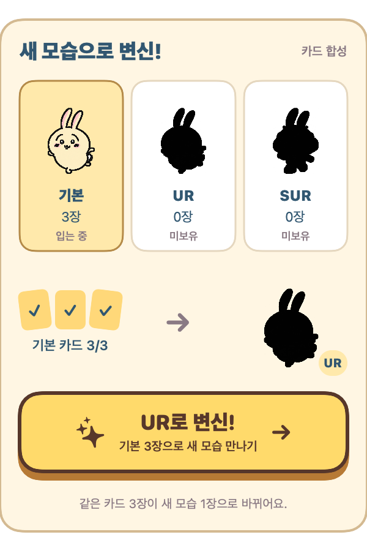

# 치이카와 키우기

비영리·수익 없는 비공식 팬 앱입니다.

[](https://github.com/kitesik/ChiiBar-releases/releases/latest/download/ChiiBar-macOS.zip)

**[Mac용 다운로드](https://github.com/kitesik/ChiiBar-releases/releases/latest/download/ChiiBar-macOS.zip)** · 무료 · macOS 14 이상 · Apple Silicon / Intel  
최신 버전 **0.6.6** · [업데이트 내용](https://github.com/kitesik/ChiiBar-releases/releases/latest)

[다운로드 통계](stats/README.md) · 매일 자동 갱신 · 인원수가 아닌 다운로드 횟수

**다운받으셨다면 우측 상단 ⭐ Star 한 번 눌러 주세요. 다음 업데이트에 힘이 됩니다.**


작은 집에서 시작해요. 다음 집은 직접 만나보세요.

## 일하고, 뽑고, 키우고

- 키보드·마우스로 활동하면 집을 키우는 에너지가 쌓여요.
- 활동 **1시간마다 뽑기권 1장**. 새 친구를 만나요.
- **산책가자!**를 누르면 친구가 바탕화면을 걸어요.
- 집은 **23단계**. 어디까지 갈지는 조금씩 알아가는 걸로.

## 카드 모아 업그레이드

같은 친구 카드 **3장**을 모으면 새 모습으로 합성할 수 있어요.  
기본 → **UR** → **SUR**. 아직 없는 모습은 비밀이에요.

업그레이드 후에도 이전 모습으로 돌아갈 수 있어요. 원하는 모습을 누른 뒤 친구 선택 버튼을 누르면 돼요. 선택한 모습은 다음 실행에도 그대로예요.



0.6.0에서는 카드 합성과 새 친구들이 추가됐어요.  
세이렌, 시마지로, 히토하·후타바, 인어도 기다리고 있어요.

## 설치

1. **ChiiBar-macOS.zip**을 받아 압축을 풀어요.
2. **ChiiBar.app**을 **응용 프로그램** 폴더로 옮겨요.
3. 앱을 열고 화면 맨 위 **메뉴 막대의 캐릭터 아이콘**을 눌러요.

첫 실행이 막히면 **시스템 설정 → 개인정보 보호 및 보안 → 그래도 열기**를 확인해 주세요. 현재 Apple 공증 전 버전이에요. [Apple 안내](https://support.apple.com/ko-kr/102445)

## 이미 키우고 있다면

메뉴 막대 아이콘 우클릭 → **종료**. 새 앱을 응용 프로그램 폴더에 옮기고 **대치**하면 돼요.  
**친구·집·뽑기권은 그대로 남아요.** 자동 업데이트는 아직 없어요.

<details>
<summary>Homebrew로 설치한 경우</summary>

앱을 종료한 뒤 실행해 주세요.

```bash
brew update && brew upgrade --cask kitesik/tap/chiibar
```

</details>

<details>
<summary>활동 기록과 개인정보</summary>

- 입력한 글이나 누른 키는 읽지 않아요. macOS에서 마지막 활동 후 경과 시간을 확인해요.
- 키보드 입력·클릭·스크롤 뒤 5분까지 활동으로 계산해요. 화면 잠금·잠자기 중에는 멈춰요.
- 활동 시간과 게임 기록은 Mac에 저장해요. 서버로 보내지 않아요.
- Claude Code·Codex의 로컬 사용 로그에서 사용량 숫자를 읽어 작은 추가 경험치를 더해요.
- 저장 형식을 옮길 때 원본을 백업해요. 기존 보유 친구는 기본 카드 1장부터 시작하며, 과거 중복 뽑기는 소급하지 않아요.

</details>

설치가 어렵다면 AI에게 **이 페이지 주소**와 함께 “설치 방법 알려줘”라고 물어보세요.

---

비공식·비상업 팬 앱입니다. 원작 권리자와 관계가 없으며, 캐릭터의 권리는 원 권리자에게 있습니다.
